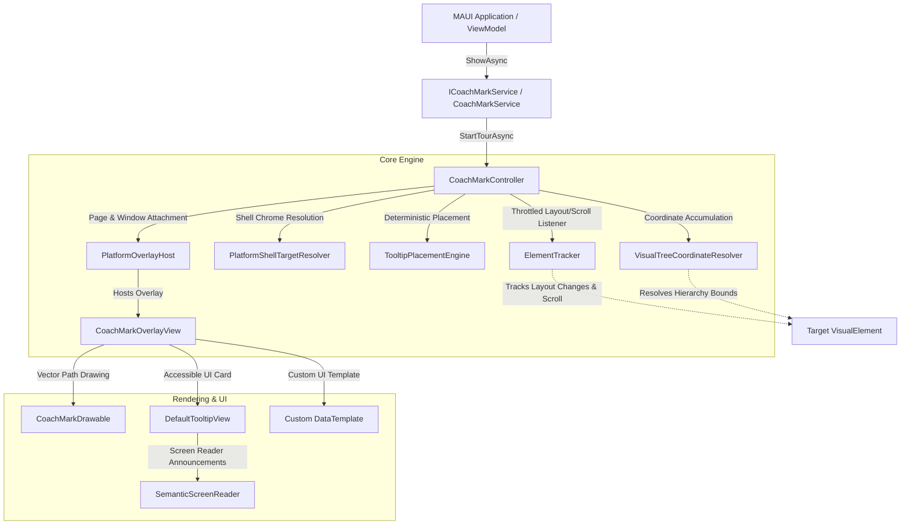

# Plugin.Maui.CoachMark

[](https://dotnet.microsoft.com/)
[](https://dotnet.microsoft.com/en-us/apps/maui)
[](LICENSE)
[]()

**Plugin.Maui.CoachMark** is a high-performance, cross-platform onboarding and feature walkthrough tour engine built specifically for **.NET MAUI**. It enables mobile and desktop applications to present interactive, animated spotlight cutouts and contextual tooltip cards that highlight specific user interface controls (`VisualElement`).


---

## 📸 Preview

<div align="center">
  
  <br/><br/>
  <i>Animated walkthrough demo showing the rounded spotlight, circular spotlight, and custom tooltip card.</i>
</div>

---

## ✨ Features

- 🎯 **Hardware-Accelerated Spotlight Cutouts**: Employs `Microsoft.Maui.Graphics` with `EvenOdd` winding mode to punch out transparent spotlight cutouts of any shape (`RoundedRectangle`, `Rectangle`, `Circle`, `Oval`) on top of a customizable dimmed backdrop mask.
- 📐 **Intelligent Tooltip Placement Engine**: Deterministically calculates the optimal card position across all four cardinal directions (`Bottom`, `Top`, `Right`, `Left`, `Center`), automatically flipping orientations when space is constrained and clamping cards within safe viewport margins.
- 🔄 **Real-Time Visual Tree & Scroll Tracking**: Dynamically tracks element position mutations, translation changes, window resizing, and ancestor `ScrollView` scroll offsets without polling threads or memory leaks.
- 📜 **Auto-Scrolling Support**: Automatically scrolls ancestor `ScrollView` containers to bring off-screen target elements smoothly into the viewport before presenting a step.
- ⚡ **Dynamic & Asynchronous Target Binding**: Supports static `VisualElement` references, lazy synchronous factories (`Func<VisualElement?>`), and asynchronous accessors (`Func<Task<VisualElement?>>`) for virtualized items (such as inside a `CollectionView`).
- 🧭 **Shell Chrome Targeting**: Highlight native `Shell` flyout (hamburger) icons and tab bar items (`ShellTarget.FlyoutIcon()`, `ShellTarget.Tab(...)`) using automatic Window-level overlay hosting across Android, iOS, Mac Catalyst, and Windows.
- 📐 **Custom `Rect` & Drawable Canvas Targets**: Target arbitrary `Rect` regions—either relative to a host `VisualElement` (such as `GraphicsView` / `IDrawable` shapes) or in absolute overlay coordinates—with static, synchronous, or async accessors.
- 🎨 **Custom XAML Templating**: Fully customize tooltip cards using custom `DataTemplate` and custom `BindingContext` definitions.
- ♿ **Accessibility Built-In**: Integrates with .NET MAUI `SemanticScreenReader` to automatically announce step titles, descriptions, and progress indicators to assistive technologies.
- 🛡️ **Memory Safe & Robust**: Uses weak references throughout visual tree tracking, guarantees complete visual tree cleanup upon page dismissal or navigation, and synchronizes transitions with mutex locking.

---

## 📱 Supported Platforms

| Platform | Minimum Supported Version | Target Framework Moniker |
| :--- | :--- | :--- |
| **Android** | Android 5.0 (API 21) or higher | `net10.0-android` |
| **iOS** | iOS 15.0 or higher | `net10.0-ios` |
| **Mac Catalyst** | macOS 12.0 (Catalyst 15.0) or higher | `net10.0-maccatalyst` |
| **Windows** | Windows 10 Build 17763.0+ / Windows 11 | `net10.0-windows10.0.19041.0` |
| **Cross-Platform / Unit Tests** | .NET 10 Core CLR | `net10.0` |

---

## 🚀 Installation

### 1. Add Package Reference
Add the package to your `.NET MAUI` project:

```xml
<ItemGroup>
    <PackageReference Include="Plugin.Maui.CoachMark" Version="1.0.0" />
</ItemGroup>
```

### 2. Register in `MauiProgram.cs`
Chain `.UseCoachMark()` onto your `MauiAppBuilder`:

```csharp
using Plugin.Maui.CoachMark;

namespace MyApp;

public static class MauiProgram
{
    public static MauiApp CreateMauiApp()
    {
        var builder = MauiApp.CreateBuilder();
        builder
            .UseMauiApp<App>()
            .UseCoachMark() // <-- Initialize and register CoachMark services
            .ConfigureFonts(fonts =>
            {
                fonts.AddFont("OpenSans-Regular.ttf", "OpenSansRegular");
                fonts.AddFont("OpenSans-Semibold.ttf", "OpenSansSemibold");
            });

        return builder.Build();
    }
}
```

---

## 💡 Quick Start

### Basic Walkthrough Tour

```csharp
using Plugin.Maui.CoachMark;

public partial class MainPage : ContentPage
{
    private readonly ICoachMarkService _coachMarkService;

    public MainPage(ICoachMarkService coachMarkService)
    {
        InitializeComponent();
        _coachMarkService = coachMarkService;
    }

    private async void OnStartTourClicked(object sender, EventArgs e)
    {
        var steps = new List<CoachMarkStep>
        {
            new CoachMarkStep(
                target: SearchInput,
                title: "Instant Search",
                description: "Quickly locate records and files in your library.")
            {
                Placement = CoachMarkPlacement.Bottom,
                Shape = SpotlightShape.RoundedRectangle,
                SpotlightCornerRadius = 10f
            },
            new CoachMarkStep(
                target: SettingsButton,
                title: "App Settings",
                description: "Customize theme preferences, notifications, and account credentials.")
            {
                Placement = CoachMarkPlacement.Bottom,
                Shape = SpotlightShape.Circle
            },
            new CoachMarkStep(
                target: CreateButton,
                title: "Create New Record",
                description: "Tap here whenever you want to add a new project.")
            {
                Placement = CoachMarkPlacement.Top,
                Shape = SpotlightShape.RoundedRectangle,
                SpotlightCornerRadius = 24f
            }
        };

        var options = new CoachMarkOptions
        {
            OverlayOpacity = 0.75f,
            SpotlightBorderColor = Color.FromArgb("#818CF8"),
            SpotlightBorderWidth = 2f,
            AccentColor = Color.FromArgb("#512BD4"),
            AnimationDuration = TimeSpan.FromMilliseconds(300)
        };

        CoachMarkResult result = await _coachMarkService.ShowAsync(steps, options);

        if (result.IsCompleted)
        {
            await DisplayAlert("Completed", "You finished the onboarding tour!", "OK");
        }
    }
}
```

### Single Standalone Callout

```csharp
var step = new CoachMarkStep(
    target: ActionButton,
    title: "New Feature",
    description: "Tap here to access the new analytics dashboard.")
{
    Placement = CoachMarkPlacement.Right,
    Shape = SpotlightShape.RoundedRectangle
};

await _coachMarkService.ShowAsync(step, new CoachMarkOptions { DismissOnOutsideTap = true });
```

---

## ⚙️ Configuration (`CoachMarkOptions`)

Customize global defaults or individual tour behaviors:

| Option | Type | Default | Description |
| :--- | :--- | :--- | :--- |
| `OverlayColor` | `Color` | `Colors.Black` | Backdrop mask fill color. |
| `OverlayOpacity` | `float` | `0.72f` | Alpha opacity of the dimmed backdrop (`0.0` to `1.0`). |
| `SpotlightPadding` | `Thickness` | `new Thickness(8)` | Default padding added around the target control's bounds. |
| `SpotlightCornerRadius` | `float` | `8f` | Default corner radius for rounded rectangle spotlights. |
| `SpotlightBorderColor` | `Color?` | `null` | Optional border stroke color drawn around the spotlight cutout. |
| `SpotlightBorderWidth` | `float` | `0f` | Thickness of the spotlight border stroke in pixels. |
| `SpotlightBorderDashPattern` | `float[]?` | `null` | Stroke dash pattern for spotlight border (e.g. `new float[] { 4, 4 }`). |
| `DefaultSpotlightShape` | `SpotlightShape` | `RoundedRectangle` | Default cutout shape (`RoundedRectangle`, `Rectangle`, `Circle`, `Oval`). |
| `AnimationDuration` | `TimeSpan` | `250ms` | Transition and fade animation duration. |
| `AnimationEasing` | `Easing` | `Easing.CubicInOut` | Easing function applied to spotlight movements. |
| `EnableAnimations` | `bool` | `true` | When `false`, spotlight and tooltip snap immediately without animation. |
| `PreferredPlacement` | `CoachMarkPlacement`| `Auto` | Default card orientation (`Auto`, `Top`, `Bottom`, `Left`, `Right`, `Center`). |
| `OverlayHostMode` | `CoachMarkOverlayHostMode` | `Auto` | Overlay attachment mode (`Auto`, `Page`, `Window`). `Auto` uses Window hosting when any step targets a `ShellTarget`, otherwise Page hosting. |
| `AllowTargetInteraction` | `bool` | `false` | When `true`, touches within the spotlight pass to the underlying control. |
| `DismissOnOutsideTap` | `bool` | `false` | When `true`, tapping outside the spotlight dismisses the active tour. |
| `AdvanceOnTargetTap` | `bool` | `false` | When `true`, tapping inside the spotlight advances to the next step. |
| `ShowStepIndicator` | `bool` | `true` | Displays step badge (e.g., `"STEP 1 OF 3"`) on multi-step tours. |
| `ScrollToTargetIfNeeded` | `bool` | `true` | Automatically scrolls ancestor `ScrollView` to center the target element. |
| `TooltipSpacing` | `double` | `12.0` | Gap in pixels between spotlight cutout edge and tooltip card. |
| `SafePadding` | `Thickness` | `new Thickness(16)` | Boundary margin preventing tooltips from clipping screen edges. |
| `TooltipTemplate` | `DataTemplate?` | `null` | Global custom `DataTemplate` for tooltip card UI. |
| `NextButtonText` | `string` | `"Next"` | Next button label. |
| `PreviousButtonText` | `string` | `"Previous"` | Previous button label. |
| `SkipButtonText` | `string` | `"Skip"` | Skip button label. |
| `FinishButtonText` | `string` | `"Got it"` | Action button label on the final step. |
| `CardBackgroundColor` | `Color` | `Colors.White` | Card container background color. |
| `TitleTextColor` | `Color` | `#1F2937` | Step title text color. |
| `DescriptionTextColor` | `Color` | `#4B5563` | Step description text color. |
| `AccentColor` | `Color` | `#512BD4` | Theme accent for buttons, badges, and highlights. |
| `OnStepAppearing` | `Action<CoachMarkStep, int>?` | `null` | Callback invoked before a step appears. |
| `OnStepDisappeared` | `Action<CoachMarkStep, int>?` | `null` | Callback invoked after a step disappears. |

---

## 🎯 Step Customization (`CoachMarkStep`)

Each `CoachMarkStep` can override global options individually:

```csharp
var step = new CoachMarkStep(MyTarget, "Title", "Description")
{
    Placement = CoachMarkPlacement.Top,
    Shape = SpotlightShape.Circle,
    SpotlightPadding = new Thickness(12),
    SpotlightBorderColor = Colors.DeepSkyBlue,
    SpotlightBorderWidth = 3f,
    DismissOnOutsideTap = true,
    AdvanceOnTargetTap = true,
    BeforeShowAsync = async () =>
    {
        // Execute setup logic before step displays (e.g. switch tabs or scroll)
        return true; // Return false to skip step
    },
    AfterDismissAsync = async () =>
    {
        // Execute teardown or analytics logging after step finishes
        await Task.CompletedTask;
    }
};
```

---

## 🔥 Advanced Scenarios

### 1. Dynamic & Asynchronous Targets (e.g. inside `CollectionView`)
Target elements that load dynamically or are created inside item templates:

```csharp
var step = new CoachMarkStep(
    asyncTargetAccessor: async () =>
    {
        await Task.Delay(100); // Allow list to inflate
        return ItemsList.FindByName<VisualElement>("FirstActionButton");
    },
    title: "Item Action",
    description: "Tap to inspect this dynamically generated record.");
```

### 2. Custom XAML Tooltip Templates
Replace the default tooltip card with your own styled layout:

```xaml
<DataTemplate x:Key="CustomCardTemplate">
    <Border BackgroundColor="#1E293B"
            StrokeShape="RoundRectangle 16"
            Stroke="#38BDF8"
            StrokeThickness="2"
            Padding="16">
        <VerticalStackLayout Spacing="8">
            <Label Text="{Binding Title}" TextColor="#38BDF8" FontAttributes="Bold" FontSize="16" />
            <Label Text="{Binding Description}" TextColor="#E2E8F0" FontSize="13" />
        </VerticalStackLayout>
    </Border>
</DataTemplate>
```

```csharp
var step = new CoachMarkStep(MyTarget, "Custom UI", "Rendered using custom XAML DataTemplate")
{
    CustomTemplate = (DataTemplate)Resources["CustomCardTemplate"]
};
```

### 3. Tour Cancellation via `CancellationToken`

```csharp
using var cts = new CancellationTokenSource(TimeSpan.FromSeconds(5));

var result = await _coachMarkService.ShowAsync(steps, cancellationToken: cts.Token);
if (result.IsCanceled)
{
    // Tour timed out or was canceled
}
```

### 4. Shell Flyout (Hamburger), Sidebar Items & Tab Bar Icons

Target native `Shell` navigation bar, open sidebar (`FlyoutItem`), and tab bar items with `ShellTarget`. By default, `CoachMarkOverlayHostMode.Auto` automatically promotes the tour to Window-level overlay hosting whenever any step targets a `ShellTarget`:

> **Tip:** When combining a `Shell` flyout menu with a bottom/top tab bar in `AppShell.xaml`, set `FlyoutDisplayOptions="AsSingleItem"` on your `FlyoutItem` so MAUI renders both the hamburger toggle button and the `TabBar`.

```csharp
var steps = new List<CoachMarkStep>
{
    new CoachMarkStep(
        shellTarget: ShellTarget.FlyoutIcon(),
        title: "Navigation Menu",
        description: "Tap the hamburger icon to open the Shell flyout drawer.")
    {
        Placement = CoachMarkPlacement.Bottom,
        Shape = SpotlightShape.Circle
    },
    new CoachMarkStep(
        shellTarget: ShellTarget.FlyoutItem("About"),
        title: "Sidebar Item",
        description: "Open the sidebar in BeforeShowAsync to spotlight items inside the drawer.")
    {
        Placement = CoachMarkPlacement.Right,
        Shape = SpotlightShape.RoundedRectangle,
        BeforeShowAsync = async () =>
        {
            if (Shell.Current is { FlyoutIsPresented: false } shell)
            {
                shell.FlyoutIsPresented = true;
                await Task.Delay(300); // Wait for drawer slide-in animation
            }
            return true;
        },
        AfterDismissAsync = async () =>
        {
            if (Shell.Current is { FlyoutIsPresented: true } shell)
            {
                shell.FlyoutIsPresented = false;
                await Task.Delay(250);
            }
        }
    },
    new CoachMarkStep(
        shellTarget: ShellTarget.Tab(0),
        title: "Home Tab",
        description: "Targets the first tab bar item by zero-based index.")
    {
        Placement = CoachMarkPlacement.Auto,
        Shape = SpotlightShape.RoundedRectangle
    },
    new CoachMarkStep(
        shellTarget: ShellTarget.Tab("Details"),
        title: "Details Tab",
        description: "Targets a tab bar item by title or route.")
    {
        Placement = CoachMarkPlacement.Auto,
        Shape = SpotlightShape.RoundedRectangle
    }
};

var options = new CoachMarkOptions
{
    OverlayHostMode = CoachMarkOverlayHostMode.Auto
};

await _coachMarkService.ShowAsync(steps, options);
```

### 5. Custom `Rect` & `GraphicsView` / `IDrawable` Regions

Highlight specific drawn regions inside a `GraphicsView` (relative to the host `VisualElement`, tracking scroll and resize automatically) or specify an absolute `Rect` in the overlay coordinate space:

```csharp
var steps = new List<CoachMarkStep>
{
    // Relative Rect inside a GraphicsView / IDrawable (static, Func<Rect?>, or Func<Task<Rect?>>)
    new CoachMarkStep(
        relativeTo: DemoGraphicsView,
        rectAccessor: () => _demoDrawable.PrimaryNodeRect,
        title: "Chart Peak",
        description: "Highlights a specific Rect drawn inside a GraphicsView IDrawable.")
    {
        Placement = CoachMarkPlacement.Top,
        Shape = SpotlightShape.RoundedRectangle,
        SpotlightCornerRadius = 10f
    },

    // Absolute Rect in overlay coordinates (static, Func<Rect?>, or Func<Task<Rect?>>)
    new CoachMarkStep(
        targetRect: new Rect(24, 48, 120, 60),
        title: "Custom Region",
        description: "Highlights a fixed rectangle in the overlay coordinate space.")
    {
        Shape = SpotlightShape.Rectangle
    }
};

await _coachMarkService.ShowAsync(steps);
```

---

## 🏛️ Architecture



---

## 🧪 Testing

The solution includes automated unit tests covering geometry calculations, collision avoidance, coordinate accumulation, and state transitions.

Run tests using the .NET CLI:
```powershell
dotnet test tests/Plugin.Maui.CoachMark.Tests/Plugin.Maui.CoachMark.Tests.csproj
```

---

## 📁 Sample Application

A full-featured showcase app is available in the [`samples/CoachMarkSample`](samples/CoachMarkSample) folder. It demonstrates:
- Multi-step walkthrough tours
- Deep-scroll auto-positioning
- Circular and rounded rectangle spotlights
- Single-step highlights
- `CancellationToken` timeouts
- Page navigation dismissal safety
- Shell flyout (hamburger) icon & open sidebar item targeting (`ShellTarget.FlyoutIcon`, `ShellTarget.FlyoutItem`)
- Shell tab bar icon targeting (`ShellTarget.Tab`)
- Custom `Rect` targeting inside a `GraphicsView` / `IDrawable` canvas

---
